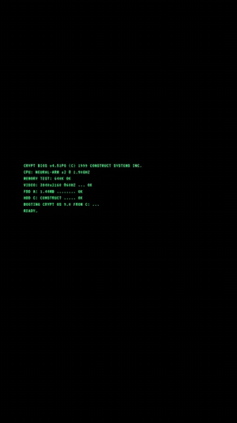
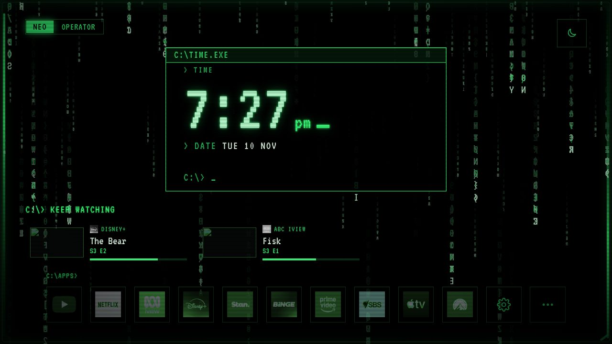
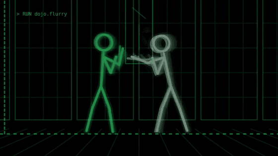
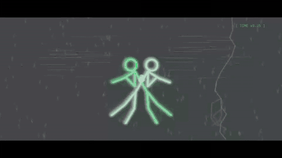
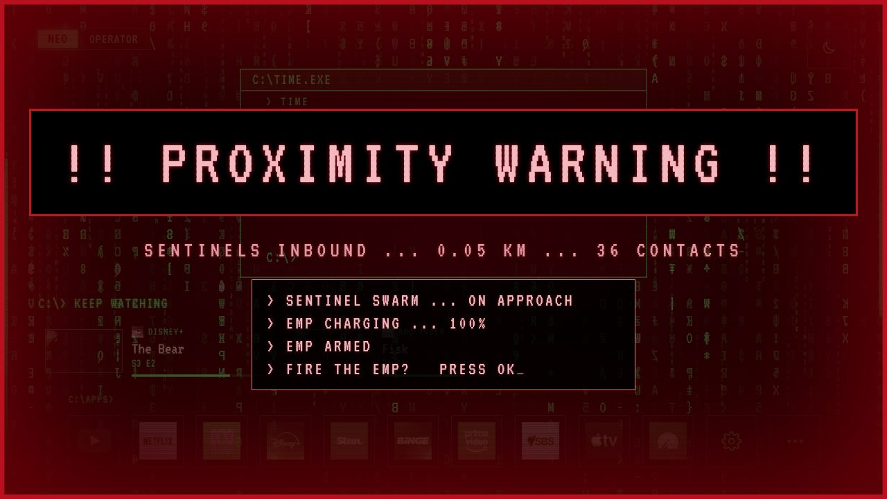
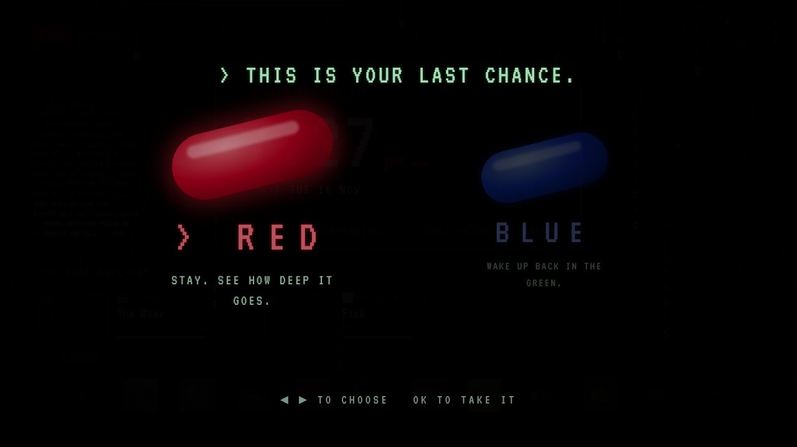
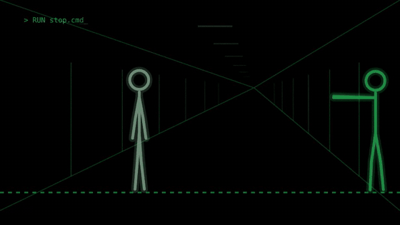
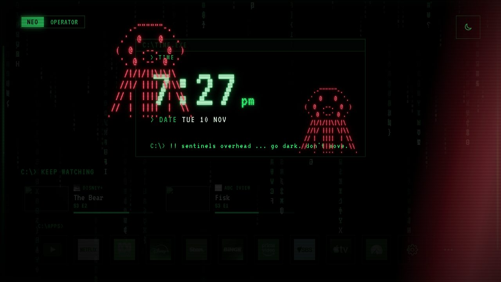
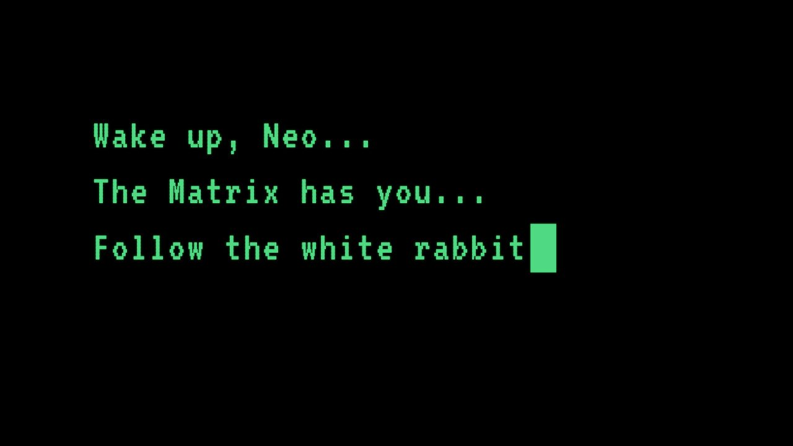
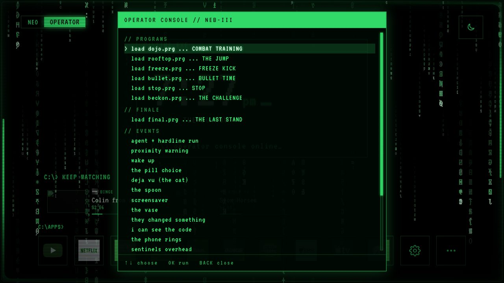

# Matrix TV Home Screen: The Construct

**Your TV's home screen, turned into the Matrix.** Code rain, a 90s terminal clock, random events
you answer with the remote, a hidden passcode, and a screensaver that replays the film's fights.

   
  <b><a href="docs/matrix/the-construct-trailer.mp4">▶ Watch the trailer</a></b> (70 seconds, made for your phone)

**[▶ Try it in your browser](https://pixel-vision.github.io/Matrix_TV_The_Construct/demo/)**:
your keyboard is the remote (on a phone, use the on-screen one). The apps and shows are samples,
and nothing in the demo reaches a real TV.

<table>
  <tr>
    <td width="50%"> <b>The screensaver:</b> the dojo, one of six fights from the film</td>
    <td width="50%"> <b>The Last Stand:</b> the final fight with Smith, playable on the remote</td>
  </tr>
  <tr>
    <td> <b>Sentinels inbound:</b> press OK to fire the EMP before they arrive</td>
    <td> <b>The pill choice:</b> blue puts it back, red breaks the construct apart</td>
  </tr>
  <tr>
    <td> <b>stop.cmd:</b> "no." The bullets stop, he takes one, then lets them fall</td>
    <td> <b>Moments:</b> sentinels overhead, the white rabbit, deja vu and more</td>
  </tr>
</table>

It runs on Google TV and Android TV (built and tested on a Sony BRAVIA; [which TVs?](#will-it-work-on-my-tv)) as a replacement home screen, with no
ads, your apps along the bottom and "keep watching" for your shows. When the TV goes idle, the
screensaver plays the fights from the first film, drawn live in code, and the remote can drop you
into the final battle with Agent Smith. It is a customised build of
[couch-tv](https://github.com/Seagey/couch-tv).

## What it does

- **A home screen in the Matrix.** The clock and date sit in a terminal window over falling code.
  The code above the app you're on falls in that app's colour, and the screen edges glow with it,
  so a TV backlight that follows the picture lights the room to match.
- **Rain that follows your weather.** The terminal shows your local weather, and the code rain
  reacts to it: it pours harder when it's raining outside, thins out on a clear day, and in a
  thunderstorm lightning flashes across the screen (and the room, if your lights follow the TV).
- **A construct that does things on its own.** While the home screen is up, something happens
  every few minutes. Some of it you just watch; some of it needs you to pick up the remote.
- **A screensaver that plays the films.** When the TV is idle, the rain spells out the time, then
  plays one of six fights from *The Matrix*, in the order they come in the film, with sets drawn
  behind them. Wake it mid-fight and the command line answers with a line from that scene.
- **An operator console.** Pick the **Operator** profile and you get a console to run any fight,
  set off any event, play the finale, or leave a message for the other profile.
- **The Last Stand.** The final fight between Neo and Smith from the end of the trilogy, written
  as a playable scene: you trade blows, charge the sky clashes and let Smith in at the end.

## It keeps you on your toes

The home screen doesn't just sit there. Leave it up and the construct starts to move:

| What happens | How often | What you do |
|---|---|---|
| **A moment from the film** (below) | every 5 to 10 minutes | some need a press; most just play |
| **An agent finds you** | every 9 minutes, taking turns with the proximity warning | get to a hardline: follow the arrows on screen, then press OK to answer the phone before he reaches you |
| **Proximity warning**: sentinels inbound | every 9 minutes, taking turns with the agent | press **OK to fire the EMP** before they arrive (the operator fires it after 12 seconds if you don't) |
| **Wake up, Neo**: the screen is taken over and the construct goes red | when you enter the passcode (below), or from the console | in red, agents come every 1 to 2 minutes |
| **The pill choice** | the passcode again while red, or from the console | **◀ ▶** to choose, **OK** to take it: blue puts it all back; red sends you through the mirror and breaks the construct apart |

Everything pauses while an app or the screensaver is on, so nothing is wasted while you're
watching something.

### The passcode

Some of it is hidden. There's a passcode you key in on the remote's arrow buttons, right there on
the home screen, with nothing on screen to tell you it exists. Enter it and the construct wakes
up: the screen goes black, *Wake up, Neo...* types itself out, and everything turns red. Enter it
again while red and Morpheus holds out the pills. And if you took the red pill and the construct
has broken apart, every button is dead except the passcode, the only way to get the pills back.

The passcode (spoiler)

**▲ ▲ ▼ ▼ ◀ ▶ ◀ ▶** on the remote's arrows. Only the last eight presses count, so if you slip,
just start again.

### The moments

Small scenes from the film turn up while you browse:

- **Deja vu:** a black cat walks across the screen, then the same cat again, and the command line
  glitches: *a glitch in the matrix*.
- **The white rabbit:** *follow the white rabbit.*
- **Sentinels overhead:** squid-like sentinels drift over the clock with their searchlights.
- **The phone rings:** press **OK** to answer it.
- **The vase:** press any key and you knock it over. *What's really going to bake your noodle...*
- **They changed something:** one of your app tiles pops out of the wall and settles back.
- **I can see the code**, **the red dress** and **an agent speaks**, with lines on the command line.

## The screensaver fights

When the TV goes idle, the rain spells the time, then a fight plays, a different one each time,
in the order of the film. Each has its own set drawn behind it, and the screen edges flash with
the big hits.

| | Scene | From the film | The line afterwards |
|---|---|---|---|
| 1 | `freeze.kick` | Trinity in the hotel room: up into the crane, time stops, the camera circles, the kick | *no, lieutenant. your men are already dead.* |
| 2 | `dojo.flurry` | The sparring program: the stances, the flurry, the jumping triple kick, over Morpheus, up the wall and into the other one | *stop trying to hit me and hit me.* |
| 3 | `rooftop.leap` | The jump program: Morpheus clears it, Neo doesn't, and the street bends like rubber | *nobody makes the first jump.* |
| 4 | `bullet_time.exe` | The rooftop: bending back under the bullets, grazed twice, then Trinity | *dodge this.* |
| 5 | `beckon.exe` | The subway: the stance, the beckon, the mid-air collision, the wall, the train | *my name ... is neo.* |
| 6 | `stop.cmd` | The corridor: "no." The bullets stop; he takes one, then lets them all fall | *no. ... he is the one.* |

## The operator console

Make a profile called **Operator** and the home screen gives it a console: load any fight as a
program, set off any event or moment on cue, play the finale, run the screensaver, or leave a
message that turns up for the other person on their next visit.

## The Last Stand

`load final.prg` runs the final fight of the trilogy: Smith alone in the rain with his copies
watching, the exchange, the climb into the sky, the hammer blow and the crater, the beatdown, and
the choice. It's interactive: when a prompt flashes up you press the arrow it shows to strike or
block, OK to charge the sky clashes, and OK to let him in at the end. Leave the remote down and it
plays itself.

## The remote

| Button | What it does |
|---|---|
| **Arrows / OK** | move around the home and open apps, as normal; also the hardline run, the EMP, the pill choice and the finale prompts |
| **Back** | leaves the console, a program or a hardline run; dismisses a result |
| **Any button** | wakes the screensaver; knocks over the vase |
| **The passcode** | wakes the construct, brings up the pills, and is the only way back from a broken construct (see above) |

## Will it work on my TV?

It's built for **Google TV and Android TV**. That's where it replaces the home screen and the
screensaver, and where everything on this page works.

| Your TV | Works? |
|---|---|
| **Google TV** (Sony, TCL, Philips, Hisense Google TV and others) | **Yes, everything.** Built and tested on a Sony BRAVIA |
| **Google TV box** (Google TV Streamer, Chromecast with Google TV, Onn) | **Yes, everything** |
| **Older Android TV** (Android 7.1 to 11), **Nvidia Shield** | **Yes** (the Shield is untested) |
| **Fire TV stick on Fire OS** (Stick 4K, 4K Max, Cube) | **Partly.** The Matrix home works, but Amazon's home flashes up for a moment before it comes back. The Matrix screensaver is untested |
| **Samsung** (Tizen) and **LG** (webOS) | **Partly.** The Matrix home runs as an app, not as the real home screen, and needs a computer at home that stays on to open it each time. The remote's Home button still opens the TV's own menu. **No screensaver fights**: the screensaver is an Android feature |
| **Roku, Apple TV, Hisense VIDAA, Fire TV on Vega OS** | **No** |

**Not sure what yours runs?** On the TV, open **Settings → System → About** (or **Device
Preferences → About**). If it says **"Android TV OS"**, it works. Brands like Hisense and Sharp sell
both kinds, so it depends on the model, not the brand.

**No luck?** A Google TV box plugged into the TV's HDMI gets you everything, on any TV.

## Setting it up

It installs the same way couch-tv does: the full guide, including which TVs it works on and how
to undo it, is in [docs/COUCH-TV.md](docs/COUCH-TV.md). The short version:

1. Turn on developer mode and USB debugging on the TV.
2. Copy `config.example.json` to `config.json` and set `"look": "crypt"` under `home`.
3. Build the app (`scripts/build-apk.sh`) and put it on the TV with `apply.sh`, or `apply.py` on
   Windows, with `SCREENSAVER=crypt` so the Matrix screensaver replaces the TV's own.

Moments, the fights in the screensaver and the scenery behind them can each be switched on or off
in `config.json`. Everything can be undone ([docs/UNINSTALL.md](docs/UNINSTALL.md)).

## Credits

- Built on [couch-tv](https://github.com/Seagey/couch-tv) by Seagey and its contributors (their
  credits are in [docs/COUCH-TV.md](docs/COUCH-TV.md#credits)).
- Inspired by *The Matrix* (1999) and its sequels. This is a fan project, not affiliated with or
  endorsed by Warner Bros.; the films' names, characters and lines belong to their owners.
- Font: VT323 (SIL Open Font Licence). Weather: Open-Meteo.

MIT licence, see [LICENSE](LICENSE).
